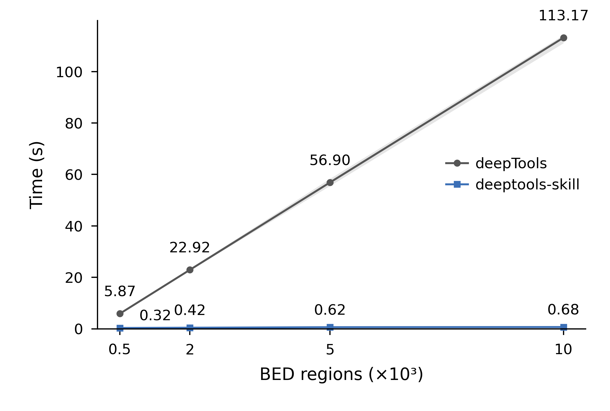

# deeptools-skill

[中文](#中文) | [English](#english)

## 中文

从已有 BigWig 和 BED 生成 ChIP-seq、CUT&Tag、CUT&RUN 的聚合 profile 和信号 heatmap，可在 Codex、DeepSeek Harness（dsh）中使用，也提供 Python API。

项目使用独立的计算实现，对照 deepTools 3.5.1 的 BED3 至 BED6、mean 分箱语义。适合已经准备好信号轨道、需要反复调整 profile 和 heatmap 的分析。

### 分析流程

- TSS 默认以 5′ 边界为中心、上下游各 2 kb；TE / peak / 普通区间默认同时计算 center（±3 kb）和 body（本体缩放 5 kb、两侧各 3 kb），bin 为 50 bp。
- 精确读取 BigWig，支持多进程和原始矩阵缓存；改配色、标签和排序无需重读信号。
- center/body 使用相同位点、共同排序；默认保留零信号行，可选联合全零过滤。
- 每个样本独立显示；profile 使用原始单位，heatmap 使用每张图全部样本共用的最大值归一化及 99% 分位色阶。
- 先预览再保存 PDF + 600 dpi PNG。默认只保存图形和必要缓存；实际绘图数值仅按明确要求导出。

输入 BigWig 必须已完成所需归一化，BED 与 BigWig 必须使用相同参考基因组和染色体命名。TSS 使用有明确链方向的完整 gene BED。工具不处理 FASTQ/BAM、peak calling、BED12 exon 拼接、聚类或官方 `.mat.gz` 输出。

### 与 deepTools 对比

| 项目 | deepTools | deeptools-skill |
| --- | --- | --- |
| 计算范围 | reference-point、scale-regions，可处理 GTF/BED12 和多种分箱统计 | BED3 至 BED6，mean 分箱；TSS、center 和 body 常用流程 |
| 重画图 | 从 `computeMatrix` 的压缩矩阵调用绘图命令 | 从 NumPy 缓存返回 Matplotlib 图对象，预览后保存 |
| center/body 行序 | 可导出排序后的 BED，再用于其他图 | 自动使用共同位点和同一份 center 排序 |
| 热图样式 | 通过命令行设置布局、色板、色阶和聚类 | 默认蓝色渐变、共同最大值归一化、99% 分位色阶和矩形色标 |
| 输出 | 支持 PNG、PDF、SVG、EPS | 默认 PDF 和 600 dpi PNG |

官方功能见 [computeMatrix](https://deeptools.readthedocs.io/en/3.5.1/content/tools/computeMatrix.html) 和 [plotHeatmap](https://deeptools.readthedocs.io/en/3.5.1/content/tools/plotHeatmap.html)。需要 exon 拼接、聚类或其他统计量时，请使用 deepTools。

### 当前绘图样式

示例使用两个合成信号轨道和 500 个区域，保留默认配色与尺寸，省去重复标题。图形仅演示布局，不代表生物学结果。

| 对齐方式 | Profile | Heatmap |
| --- | --- | --- |
| Center |  |  |
| Body |  |  |

Profile 为 60 × 45 mm，两样本 heatmap 为 90 × 80 mm，文字 6 至 7 pt。蓝色与暖橙色区分样本，热图使用浅蓝到深蓝的连续色板。PDF 保留文字和线条为矢量，热图栅格层按 600 dpi 输出。

Profile 保留输入单位。每张 heatmap 用全部所选位点、样本和 bin 的共同最大值归一化，再将第 99 百分位向上取整为色阶上限；超过上限的值只在颜色上饱和。center 与 body 分别归一化，比较绝对强度时应看 profile。

### 速度对比



| 区域数 | deepTools（秒） | deeptools-skill（秒） | 本次测试的耗时比 |
| ---: | ---: | ---: | ---: |
| 500 | 5.87 | 0.32 | 18.6× |
| 2,000 | 22.92 | 0.42 | 55.0× |
| 5,000 | 56.90 | 0.62 | 92.1× |
| 10,000 | 113.17 | 0.68 | 167.2× |

测试使用同一条 5 Mb 合成染色体上的两条 BigWig，记录间隔 50 bp，BED 区域长 300 至 2,500 bp，区域允许重叠。两种工具均使用 1 个 worker、50 bp bin、本体缩放 5 kb、两侧各 3 kb、缺失填零，并保留零信号行。对照工具为 deepTools 3.5.1；两者使用 Python 3.8.10、NumPy 1.23.5 和 pyBigWig 0.3.18。

每种规模先预热，再交替执行两种工具，各测 3 次。折线为中位数，阴影为最小值到最大值。计时从启动 CLI 到矩阵写完，包括解释器启动、读取、计算和写盘，不含绘图，也不复用矩阵缓存。deepTools 写压缩文本，skill 写 NumPy 缓存，这种格式差异包含在耗时中。

每次测量后均逐行核对两套矩阵，使用 `atol=5.1e-7, rtol=1e-7` 容差。这些数据来自同一组可复现的合成输入；实际速度还取决于区域密度、轨道覆盖和存储速度。

[原始测速数据](assets/benchmark.csv)包含每次运行的秒数。安装运行依赖和 deepTools 3.5.1 后，可从仓库根目录重建测速图和样式图：

```bash
python scripts/benchmark_readme.py --output assets
```

### 下载与安装

以下命令从 `deeptools-skill` 的 `main` 分支下载，需要联网。

#### 在 Codex 对话中安装

```text
$skill-installer 请从 https://github.com/XIXIKA-123/deeptools-skill/tree/main/skills/deeptools 安装 deeptools skill。
```

安装后可输入 `$deeptools`，或直接要求使用 deeptools skill。若尚未显示，重启 Codex。这需要 Codex 内置的 `skill-installer`。[Codex 官方安装与目录说明](https://learn.chatgpt.com/docs/build-skills)

#### 从命令行安装到 Codex 或 dsh

在 Bash 中运行；需要 `curl` 和 `unzip`。命令将完整 skill 放入 Codex 和 dsh 共用的 `~/.agents/skills`。已有同名目录时停止，避免覆盖。

```bash
REPO_OWNER="XIXIKA-123"
REPO_REF="main"
(
  set -e
  SKILL_DEST="$HOME/.agents/skills/deeptools"
  if [ -e "$SKILL_DEST" ] || [ -L "$SKILL_DEST" ]; then
    echo "Already exists: $SKILL_DEST; back it up before updating." >&2
    exit 1
  fi
  DOWNLOAD_TMP=$(mktemp -d)
  trap 'rm -rf "$DOWNLOAD_TMP"' EXIT
  curl -fL "https://github.com/${REPO_OWNER}/deeptools-skill/archive/refs/heads/${REPO_REF}.zip" \
    -o "$DOWNLOAD_TMP/source.zip"
  unzip -q "$DOWNLOAD_TMP/source.zip" -d "$DOWNLOAD_TMP"
  mkdir -p "$(dirname "$SKILL_DEST")"
  cp -R "$DOWNLOAD_TMP/deeptools-skill-${REPO_REF}/skills/deeptools" "$SKILL_DEST"
  echo "Installed: $SKILL_DEST"
)
```

也可在 GitHub 页面选择 **Code → Download ZIP**，解压后复制 `skills/deeptools` 整个目录。

| 安装范围 | 目标目录 |
| --- | --- |
| Codex 与 dsh 共用，用户级 | `~/.agents/skills/deeptools` |
| Codex 与 dsh 共用，项目级 | `<项目根目录>/.agents/skills/deeptools` |
| 仅 dsh，用户级 | `${DSH_HOME:-$HOME/.dsh}/skills/deeptools` |
| 仅 dsh，项目级 | `<项目根目录>/.dsh/skills/deeptools` |

dsh 需要启用 filesystem skill provider。设置了 `DSH_AGENTS_HOME` 时，请使用对应的用户目录。复制时保留整个 skill 文件夹，并让 `deeptools` 直接位于 skill 根目录下；dsh 不会递归查找嵌套目录。安装后让 dsh“加载 deeptools skill，并按其规则分析指定 BigWig/BED”。[dsh 官方目录与发现规则](https://github.com/deepseek-ai/deepseek-harness/blob/master/packages/skill/skill-filesystem/README.md)

### Python 依赖

在选定的 Python 环境中运行下面任一命令。skill 安装器不会自动安装这些 Python 包。

```bash
# 在仓库根目录，使用当前选定的 Python 环境
python -m pip install -r requirements.txt

# 若只安装了 skill，则使用其实际安装目录，例如：
python -m pip install -r "$HOME/.agents/skills/deeptools/requirements.txt"
```

运行依赖为 NumPy、pyBigWig、Matplotlib；普通分析无需安装官方 deepTools。依赖文件列出最低版本要求。worker 数应不超过可用 CPU 数。

### 使用示例

在 Codex 或 dsh 中提供真实路径、样本组别及信号单位，例如：

```text
使用 deeptools skill，为 WT.bw 和 KO.bw 在 regions.bed 上绘制 peak profile 与 heatmap。
样本分别为 WT、KO，信号单位是 RPGC，使用 4 个可用 CPU。
缓存放 results/peak_profiles，图放 Figs/peak_profiles。先预览，再保存。
```

也可从仓库根目录在 Python notebook 中调用。替换示例数据路径；已安装 skill 时将导入路径改为该 skill 的 `scripts` 目录。

```python
import sys
from pathlib import Path
sys.path.insert(0, str(Path("skills/deeptools/scripts").resolve()))
from fast_chip_profiles import compute_profiles, make_plots, save_plots

samples = [
    dict(path="/data/WT.bw", sample="WT", group="WT"),
    dict(path="/data/KO.bw", sample="KO", group="KO"),
]
caches = compute_profiles(
    samples, {"Peaks": "/data/regions.bed"},
    "results/peak_profiles", kind="peak", workers=4,
)
```

下一 cell：绘图并预览。

```python
plots = make_plots(caches, samples=samples, style={"signal_label": "RPGC"})
for views in plots.values():
    display(views["Peaks"]["profile"])
    display(views["Peaks"]["heatmap"])
```

确认样式后另一个 cell 保存同一图对象：

```python
save_plots(plots, "Figs/peak_profiles")
```

在普通 `.py` 脚本中，把多进程调用放在 `if __name__ == "__main__":` 内。完整规则见 [SKILL.md](skills/deeptools/SKILL.md)，API、CLI、缓存和数值验证见 [方法与使用](skills/deeptools/references/methods-and-usage.md)。

### 验证与文件结构

数值对照脚本需要同一 Python 环境中的 deepTools 3.5.1，`computeMatrix` 应位于解释器所在的 `bin` 目录。测试结果写入临时目录：

```bash
VALIDATE_TMP=$(mktemp -d)
PYTHONDONTWRITEBYTECODE=1 OPENBLAS_NUM_THREADS=1 OMP_NUM_THREADS=1 \
MPLCONFIGDIR="$VALIDATE_TMP/mpl" \
python skills/deeptools/scripts/validate_fast_chip_profiles.py \
  --workdir "$VALIDATE_TMP/validation"
# 查看结果后可删除本次临时目录：rm -rf "$VALIDATE_TMP"
```

```text
deeptools-skill/
├── README.md
├── LICENSE
├── requirements.txt
├── assets/                         # README 图形与测速数据
├── scripts/benchmark_readme.py      # 生成合成数据并复现图表
└── skills/deeptools/
    ├── SKILL.md
    ├── LICENSE
    ├── requirements.txt
    ├── references/methods-and-usage.md
    └── scripts/
        ├── fast_chip_profiles.py
        └── validate_fast_chip_profiles.py
```

代码采用 [MIT 许可证](LICENSE)；依赖软件保留各自许可证。本项目与官方 deepTools 独立。

## English

Generate aggregate profiles and signal heatmaps from existing BigWig and BED files for ChIP-seq, CUT&Tag, and CUT&RUN. Use it in Codex or DeepSeek Harness (dsh), or call the Python API.

The independent implementation targets the BED3 through BED6 mean-binning semantics of deepTools 3.5.1. It is intended for analyses with prepared signal tracks where profiles and heatmaps need repeated adjustments.

### Workflow

- TSS: ±2 kb around the strand-aware 5′ boundary. TE, peak, and general intervals: center ±3 kb plus a 5 kb scaled body with 3 kb flanks. Default bins: 50 bp.
- Exact BigWig extraction, multiprocessing, and reusable raw matrix caches.
- Shared regions and sorting across center/body; zero-signal rows retained by default, with optional joint all-zero filtering.
- Individual samples remain separate. Profiles retain the input units; each heatmap uses a common maximum across its samples, with a 99th-percentile color limit.
- Preview before saving PDF and 600 dpi PNG. Numeric exports require an explicit request.

Provide normalized BigWigs and BED files with matching genome assemblies and chromosome names. TSS analysis requires stranded, full-gene BED intervals. FASTQ/BAM processing, peak calling, BED12 exon splicing, clustering, and official `.mat.gz` export are outside the scope.

### Compared with deepTools

| Feature | deepTools | deeptools-skill |
| --- | --- | --- |
| Computation | Reference-point and scale-regions, GTF/BED12, several bin statistics | BED3 through BED6, mean bins, common TSS/center/body workflows |
| Replotting | Plot commands read a compressed `computeMatrix` file | NumPy caches return Matplotlib figures for preview and saving |
| Center/body order | Export sorted regions and reuse them in another plot | Shared regions and center-based sorting are applied automatically |
| Heatmaps | Configurable layout, palettes, limits, and clustering | Blue palette, shared-maximum normalization, 99th-percentile limits, rectangular colorbar |
| Export | PNG, PDF, SVG, EPS | PDF and 600 dpi PNG by default |

See the official [computeMatrix](https://deeptools.readthedocs.io/en/3.5.1/content/tools/computeMatrix.html) and [plotHeatmap](https://deeptools.readthedocs.io/en/3.5.1/content/tools/plotHeatmap.html) documentation. Use deepTools when you need exon splicing, clustering, or other bin statistics.

### Plot style

These examples use two synthetic tracks and 500 regions, with the default colors and dimensions and repeated titles omitted. They illustrate the plot layout, not biological results.

| Alignment | Profile | Heatmap |
| --- | --- | --- |
| Center |  |  |
| Body |  |  |

Profiles are 60 × 45 mm; two-sample heatmaps are 90 × 80 mm, with 6 to 7 pt text. Blue and warm orange distinguish the profiles. Heatmaps use a light-to-dark blue palette. PDF text and lines stay vector-based, while heatmap layers are rasterized at 600 dpi.

Profiles retain the input units. Each heatmap divides by the maximum across its selected regions, samples, and bins, then rounds the 99th percentile up to a readable color limit. Larger values saturate in color without changing the matrix. Center and body heatmaps have separate normalization factors; compare their profiles for absolute signal strength.

### Speed comparison


| Regions | deepTools (s) | deeptools-skill (s) | Time ratio in this test |
| ---: | ---: | ---: | ---: |
| 500 | 5.87 | 0.32 | 18.6× |
| 2,000 | 22.92 | 0.42 | 55.0× |
| 5,000 | 56.90 | 0.62 | 92.1× |
| 10,000 | 113.17 | 0.68 | 167.2× |

The test uses two synthetic BigWigs on a 5 Mb chromosome, with records every 50 bp and overlapping BED regions of 300 to 2,500 bp. Both tools use one worker, 50 bp bins, a 5 kb scaled body, 3 kb flanks, missing values set to zero, and zero rows retained. The reference tool is deepTools 3.5.1; both use Python 3.8.10, NumPy 1.23.5, and pyBigWig 0.3.18.

After a warm-up at each size, the tools run in alternating order, three times each. Points show medians; shading shows the full range. Timing covers CLI startup, reading, computation, and writing the matrix. It excludes plotting and never reuses a computed matrix. deepTools writes compressed text; the skill writes NumPy caches, so output-format costs are part of the comparison.

Every measured run checks all matrix rows against the deepTools export with `atol=5.1e-7, rtol=1e-7`. These results describe reproducible synthetic inputs. Region density, track coverage, and storage speed affect performance on other data.

The [raw timings](assets/benchmark.csv) contain every measurement. With the runtime dependencies and deepTools 3.5.1 installed, reproduce the benchmark and style figures from the repository root:

```bash
python scripts/benchmark_readme.py --output assets
```

### Download and install

The examples install from the `main` branch of `XIXIKA-123/deeptools-skill`.

#### Install from a Codex conversation

Ask the built-in installer:

```text
$skill-installer Install the deeptools skill from https://github.com/XIXIKA-123/deeptools-skill/tree/main/skills/deeptools
```

Invoke `$deeptools` after installation. Restart Codex if the skill does not appear. See the [official Codex skill guide](https://learn.chatgpt.com/docs/build-skills).

#### Install from the command line

Use the Bash download block in the Chinese installation section above for either Codex or dsh. It downloads the GitHub ZIP and copies the complete skill into `~/.agents/skills/deeptools`, stopping if the destination already exists. Alternatively, select **Code → Download ZIP**, extract it, and copy the entire `skills/deeptools` directory to one of these locations:

| Scope | Destination |
| --- | --- |
| Shared user installation | `~/.agents/skills/deeptools` |
| Shared project installation | `<project-root>/.agents/skills/deeptools` |
| dsh user installation | `${DSH_HOME:-$HOME/.dsh}/skills/deeptools` |
| dsh project installation | `<project-root>/.dsh/skills/deeptools` |

dsh needs its filesystem skill provider enabled. A custom `DSH_AGENTS_HOME` changes its shared user root. Keep scripts and references alongside `SKILL.md`; do not add an extra repository directory inside the skill root, since dsh does not discover nested skills. Ask dsh to load the `deeptools` skill. See the [official dsh discovery rules](https://github.com/deepseek-ai/deepseek-harness/blob/master/packages/skill/skill-filesystem/README.md).

### Dependencies and usage

In your selected Python environment, run one of:

```bash
# From the repository root
python -m pip install -r requirements.txt
# Or from the installed skill
python -m pip install -r "$HOME/.agents/skills/deeptools/requirements.txt"
```

The runtime requires NumPy, pyBigWig, and Matplotlib. Official deepTools is only needed for the comparison tests. The requirements file lists minimum dependency versions. Keep the worker count within the available CPUs. Installing the skill does not install Python dependencies automatically.

Example request for either agent:

```text
Use the deeptools skill to plot WT.bw and KO.bw over regions.bed as peaks.
The groups are WT and KO, and the signal unit is RPGC. Use 4 available CPUs.
Cache in results/peak_profiles and save figures to Figs/peak_profiles.
Preview the figures before saving.
```

The Python example above runs from the repository root; replace data paths and use the installed skill's `scripts` path when appropriate. Keep computation, plotting/preview, and saving in separate notebook cells. Standalone scripts using multiprocessing need an `if __name__ == "__main__":` guard.

[SKILL.md](skills/deeptools/SKILL.md) defines the workflow. The [methods guide](skills/deeptools/references/methods-and-usage.md) covers the API, CLI, cache format, and validation (in Chinese).

### Validation

The bundled validator compares against an installed deepTools 3.5.1, with `computeMatrix` next to the Python executable. Run the temporary-directory validation command above in that environment.

Licensed under [MIT](LICENSE); dependencies retain their own licenses. This project is independent of official deepTools.
